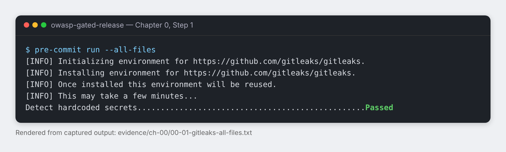
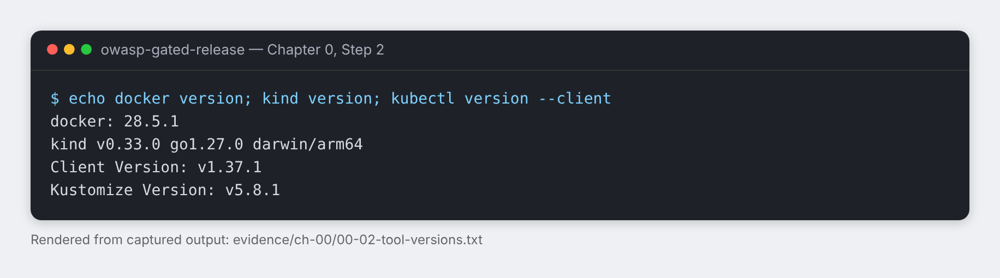
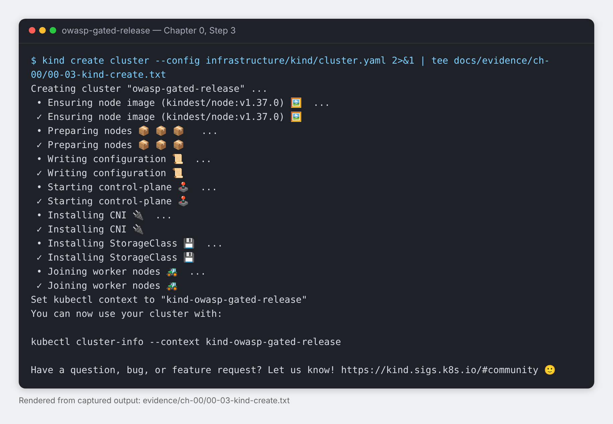
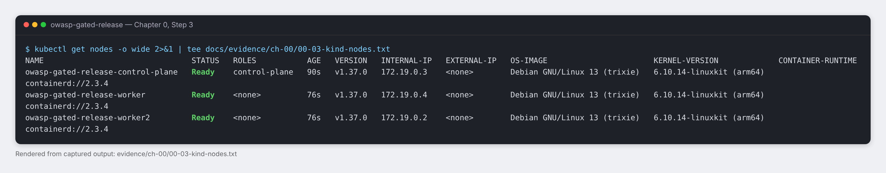

# Chapter 0: Setup and threat model

> **Status:** In progress
> **Time:** about 2 hours · **Cost:** $0 · **You will need:** a Mac or Linux laptop with 16 GB of RAM or more, Docker, Homebrew (on macOS), and a GitHub account

## Goal

By the end of this chapter you have a protected repository, a three-node Kubernetes cluster running on your laptop, and a written list of the attacks this project will stop.

## Why this matters

Security work that starts with tools tends to protect the wrong things. This chapter starts by protecting the repository itself, because it is public from the first commit, and then writes down what we are defending against before writing any application code.

## Concepts first

- **Pre-commit hook.** A script Git runs on your machine before it records a commit. Ours runs Gitleaks, which refuses the commit if it finds something that looks like a password or key. It works like a metal detector at the door: cheap, fast, and it stops the obvious mistakes before they leave the building.
- **kind (Kubernetes in Docker).** Runs a real Kubernetes cluster as Docker containers on your laptop. Each "node" is a container. It is not production, but it behaves like Kubernetes where it matters for this course: admission control, RBAC, and network policy.
- **Threat model.** A short written answer to four questions: what are we building, what can go wrong, what will we do about it, and did we do a good job? Writing it first keeps the later chapters honest.

## Before you start

You should have cloned or created this repository, and `git log --oneline` should show at least one commit.

## Steps

### Step 1: Install the secret-scanning hook and scan what is already published

Why: the hook only protects commits made *after* it is installed. If you skipped it, as we did on the first commit of this repository, anything already pushed was never scanned. So install it, then scan every file now.

```bash
brew install pre-commit
pre-commit install
mkdir -p docs/evidence/ch-00
pre-commit run --all-files 2>&1 | tee docs/evidence/ch-00/00-01-gitleaks-all-files.txt
```

Expected result:

```text
pre-commit installed at .git/hooks/pre-commit
Detect hardcoded secrets.................................................Passed
```

Evidence: Gitleaks scanned every file in the repository and found nothing ([raw output](../evidence/ch-00/00-01-gitleaks-all-files.txt)).



The first run spends a minute installing Gitleaks; later runs take about a second. From now on, every `git commit` in this repository runs this scan first.

### Step 2: Check your tools

Why: every later chapter assumes these exact tools. Recording their versions means a reader with a different version knows where a difference might come from.

```bash
brew install kind kubectl
{ echo "docker: $(docker version --format '{{.Server.Version}}')"; kind version; kubectl version --client; } 2>&1 | tee docs/evidence/ch-00/00-02-tool-versions.txt
```

Expected result: three lines with a version for Docker, kind, and kubectl. If the Docker line shows an error, Docker Desktop (or your Docker runtime) is not running; start it and run the command again.

Evidence: the tool versions this course was built with ([raw output](../evidence/ch-00/00-02-tool-versions.txt)).



| Tool | Version used in this course |
| --- | --- |
| Docker | 28.5.1 |
| kind | v0.33.0 |
| kubectl (client) | v1.37.1 |

Newer versions will usually work. If a later step behaves differently for you, compare against this table first.

### Step 3: Create the cluster

Why: every later chapter deploys into this cluster. It has three nodes: one **control plane**, which runs the Kubernetes API (the cluster's brain), and two **workers**, which run our application pods. One worker would hide behaviour we need later, such as pods spreading across machines and traffic crossing between nodes.

The whole cluster is described in one file, [`infrastructure/kind/cluster.yaml`](../../infrastructure/kind/cluster.yaml), so anyone can recreate the identical cluster. Notice what is *not* in it yet: no port mappings and no extra settings. We add configuration only when a chapter needs it, and the chapter explains why.

```bash
kind create cluster --config infrastructure/kind/cluster.yaml 2>&1 | tee docs/evidence/ch-00/00-03-kind-create.txt
kubectl get nodes -o wide 2>&1 | tee docs/evidence/ch-00/00-03-kind-nodes.txt
```

Expected result: kind prints its progress with a tick per stage (`Ensuring node image`, `Preparing nodes`, `Starting control-plane`, `Joining worker nodes`), then `kubectl get nodes` lists three nodes, `owasp-gated-release-control-plane`, `owasp-gated-release-worker`, and `owasp-gated-release-worker2`, each with status `Ready`. A node may show `NotReady` for the first 20–30 seconds while its network starts; run the second command again if so.

Evidence: the cluster was created ([raw output](../evidence/ch-00/00-03-kind-create.txt)) and all three nodes reported `Ready` ([raw output](../evidence/ch-00/00-03-kind-nodes.txt)).





What the output tells you:

- **`Ensuring node image (kindest/node:v1.37.0)`**: each node is a Docker container started from this image, which carries Kubernetes v1.37.0. The first run downloads it; later runs reuse it.
- **`Installing CNI`**: CNI (Container Network Interface) is the plug-in that gives every pod an IP address and lets pods on different nodes reach each other. kind installs its own default, called kindnet.
- **`Set kubectl context to "kind-owasp-gated-release"`**: `kubectl` can talk to many clusters, and a *context* is how it knows which one. kind switched it to this cluster for you, which is why `kubectl get nodes` worked without any extra flags.
- **`INTERNAL-IP 172.19.0.x`**: these addresses live on a private Docker network on your laptop. Nothing here is reachable from the internet.
- **`CONTAINER-RUNTIME containerd://2.3.4`**: inside each node, containerd is what actually runs your containers.

### Step 4: One-command start and stop (`make up`, `make down`)

Why: a learner, or you in three months, should not need to remember flags. The [`Makefile`](../../Makefile) wraps the commands from Step 3 into short, memorable targets, and every later chapter will add its own targets to it.

Two details are deliberate:

- **`make up` is idempotent.** If the cluster already exists, it does nothing instead of failing. Running it twice is safe.
- **`make up` waits until every node is `Ready`** before it returns, so the next command never races a half-started cluster.

Prove the whole environment can be destroyed and rebuilt from the repository alone:

```bash
make help
make down 2>&1 | tee docs/evidence/ch-00/00-04-make-down.txt
make up 2>&1 | tee docs/evidence/ch-00/00-04-make-up.txt
make status 2>&1 | tee docs/evidence/ch-00/00-04-make-status.txt
```

Expected result: `make help` lists `up`, `down`, and `status`. `make down` prints `Deleting cluster "owasp-gated-release" ...`. `make up` recreates the cluster and ends with three lines saying each node `condition met`. `make status` shows three `Ready` nodes again, with a new `AGE`.

Evidence: *pending*

### Step 5: Write the threat model

*Planned. Written when we do it.*

## What broke

1. **The commit message never closed.** The `git commit -m "...` line was missing its closing quote, so the shell showed `dquote>` and kept waiting, swallowing the next commands into the message. Fix: press `Ctrl + C`, then run one command per line. Any `dquote>` or `quote>` prompt means an open quote.
2. **The first commit was pushed without the secret scan.** `pre-commit install` was skipped, so the hook never ran on the first commit. Nothing secret was in it, but the protection we claimed was not in place. Fix: Step 1 installs the hook and scans every existing file.

## Checkpoint

- [x] `pre-commit run --all-files` passes
- [x] Tool versions are recorded
- [x] `kubectl get nodes` shows 3 nodes in `Ready` state
- [ ] `make down` then `make up` rebuilds the cluster from the repository alone
- [ ] `docs/threat-model.md` lists at least five abuse cases

## Check your understanding

1. Why does installing a pre-commit hook not protect commits that were already pushed?
2. A teammate clones this repository. Is the hook active on their machine? What would make it active?

## Next

Chapter 1: Meet the vulnerable app
