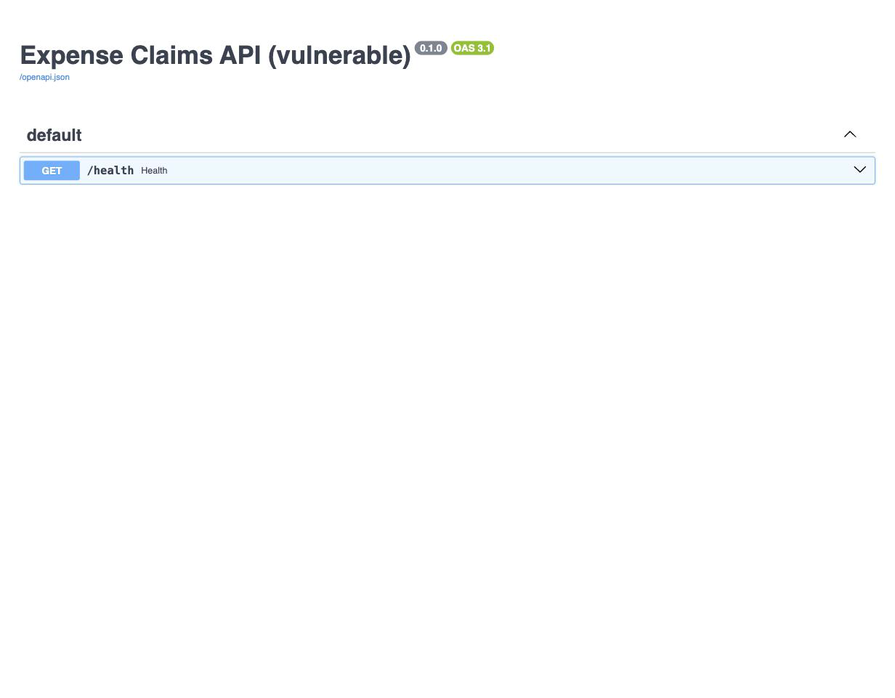
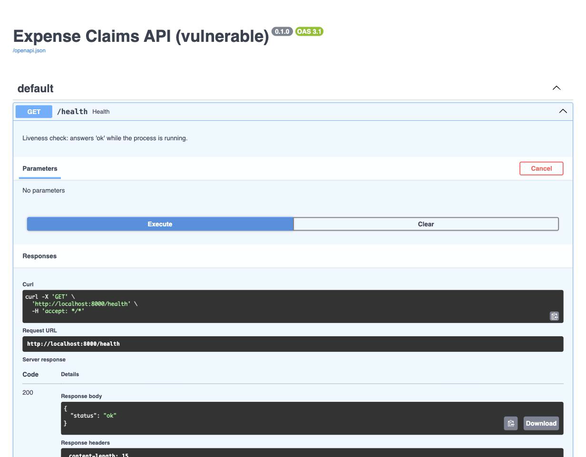
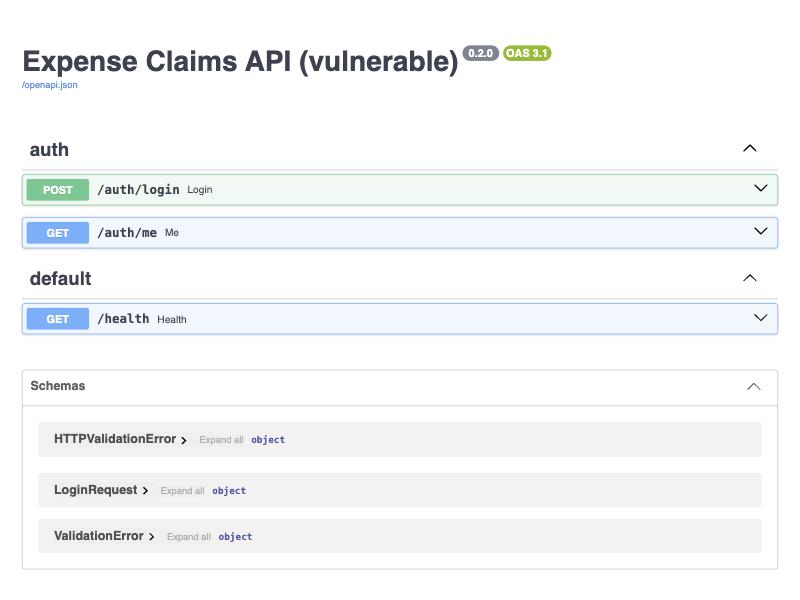
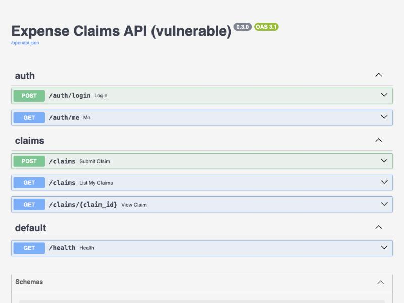
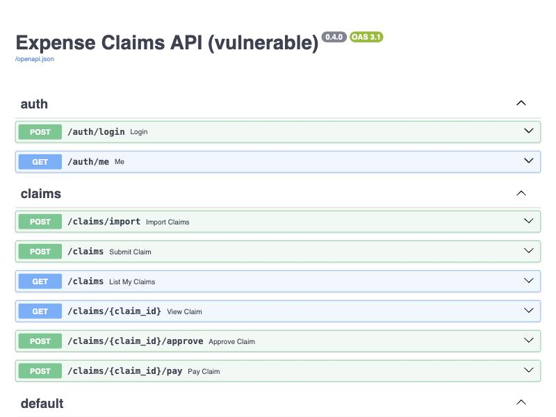

# Chapter 1: Meet the vulnerable app

> **Status:** In progress
> **Time:** about 6 hours · **Cost:** $0 · **You will need:** the Chapter 0 cluster (`make up`), Python 3.12, Docker

## Goal

By the end of this chapter, an expense-claims API is running in your cluster, you have broken it ten different ways by hand (one for each OWASP Top 10:2025 category), and a basic pipeline still gives it a green tick.

## Why this matters

You cannot judge a security gate until you have seen the attack it is meant to stop. This chapter is the "before" picture for everything that follows. Its most important lesson is uncomfortable: **a green pipeline does not mean a secure application.**

## Concepts first

*Written as each step is built.*

## The application

An expense-claims API ([ADR-0005](../adr/0005-expense-claims-api-as-the-workload.md)). Three seeded users with synthetic data:

| User | Role | Should be able to |
| --- | --- | --- |
| `alice` | employee | Submit claims and see only her own |
| `bob` | manager | Approve or reject his team's claims, but never his own |
| `carol` | finance | See approved claims and mark them paid |

| Method and path | What it does |
| --- | --- |
| `POST /auth/login` | Username and password → access token |
| `POST /claims` | Submit a claim |
| `GET /claims` | List claims, with `?search=` |
| `GET /claims/{id}` | View one claim |
| `POST /claims/{id}/approve` | Manager approves a claim |
| `POST /claims/{id}/pay` | Finance marks a claim paid |
| `POST /claims/import` | Bulk-import claims from a file |
| `GET /health` | Liveness check for Kubernetes |

## Steps

### Step 1: Create the application skeleton and run it locally

Why: start with the smallest thing that runs, prove it works, then add to it. A single `/health` endpoint is enough to check the toolchain, the test setup, and the server before any real logic exists.

**Concepts**

- **FastAPI** is a Python web framework. You write a normal function, put a decorator such as `@app.get("/health")` above it, and FastAPI turns it into a web endpoint. It also generates interactive API documentation automatically.
- **Uvicorn** is the server that runs a FastAPI app and listens for HTTP requests. FastAPI defines *what* to answer; Uvicorn handles the network.
- **A virtual environment (`.venv`)** is a private folder of Python packages for one project, so this project's versions never clash with another's. It is listed in `.gitignore`, so it is never committed.
- **Pinned versions** (`fastapi==0.161.1`, not `fastapi`) mean every install is identical. Without pins, the same code can behave differently next month. This matters again in Chapter 3, where dependencies become an attack surface.
- **Two requirements files:** `requirements.txt` is what the app needs to *run*; `requirements-dev.txt` adds what is needed only to *test*. The production image will contain only the first, which keeps test tools out of what attackers can reach.

**The files** (in [`apps/vulnerable/`](../../apps/vulnerable/)):

| File | Purpose |
| --- | --- |
| `README.md` | A loud warning that this app is deliberately insecure |
| `requirements.txt` | Runtime dependencies, pinned |
| `requirements-dev.txt` | Adds the test tools |
| `app/main.py` | The application, with one endpoint so far |
| `tests/test_health.py` | Proves `/health` answers `{"status": "ok"}` |
| `pytest.ini` | Tells pytest where to find the `app` package (see "What broke", item 2) |

**Run the test first:**

```bash
cd apps/vulnerable
python3.12 -m venv .venv
source .venv/bin/activate
pip install -r requirements-dev.txt
pytest -q 2>&1 | tee ../../docs/evidence/ch-01/01-01-pytest.txt
```

Expected result: `1 passed`.

**Then run the server and call it.** Start the server in one terminal:

```bash
uvicorn app.main:app --port 8000
```

`app.main:app` means "in the file `app/main.py`, use the object named `app`". Leave it running. In a second terminal, from the repository root:

```bash
curl -s http://localhost:8000/health | tee docs/evidence/ch-01/01-01-health.txt
```

Expected result: `{"status":"ok"}`.

Finally, open <http://localhost:8000/docs> in your browser. This is the interactive documentation FastAPI generated, called Swagger UI. Every endpoint we add will appear here, and Chapter 1's attacks can be run from this page as well as from `curl`.

Evidence: the test passed ([raw](../evidence/ch-01/01-01-pytest.txt)) and the running server answered `{"status":"ok"}` ([raw](../evidence/ch-01/01-01-health.txt)).



Clicking **Try it out**, then **Execute**, sends a real request. Swagger UI also shows the equivalent `curl` command, which is a quick way to learn `curl` syntax:


### Step 2: Add the database, users, and claims

Why: an expense app without stored data has nothing to steal. This step adds PostgreSQL, the two tables, and a seed script that resets the database to a known starting state, which every attack later in the chapter relies on.

**Concepts**

- **PostgreSQL** is the database. It stores users and claims in tables, like spreadsheets with strict column types and rules.
- **Docker Compose** runs supporting services from one file, [`compose.yaml`](../../apps/vulnerable/compose.yaml). One command starts a real PostgreSQL in a container, with nothing installed on your Mac. Compose is for your laptop only; the cluster runs its own database from Step 4.
- **SQLAlchemy** is the library that connects Python to the database. Instead of writing SQL for everything, you describe each table as a Python class, called a **model**, and SQLAlchemy translates. (One endpoint in Step 3 will deliberately skip this and build raw SQL by hand. That is where the injection lives.)
- **A foreign key** is a column that points at a row in another table. `claims.owner_id` points at `users.id`, so every claim belongs to exactly one user. `users.manager_id` points back at `users`, which is how the app knows Bob manages Alice.
- **A seed script** wipes the database and recreates the same starting data every time. Attacks change data (an approved claim stays approved), so you need a one-command way back to the start: `python -m app.seed`.

**The files**

| File | Purpose |
| --- | --- |
| `compose.yaml` | Runs PostgreSQL 18 on your laptop, reachable only from your own machine (`127.0.0.1`) |
| `app/db.py` | Creates the database connection. Reads the address from the `DATABASE_URL` environment variable, with a local default |
| `app/models.py` | The `users` and `claims` tables, as Python classes |
| `app/security.py` | Password hashing, **with the first planted flaw** (see below) |
| `app/seed.py` | Wipes and recreates the tables, then adds 3 users and 3 claims |
| `tests/test_seed.py` | Proves the seed produces exactly the expected starting state |

**The starting data** (all synthetic):

| User | Password | Role | Manager | Claims |
| --- | --- | --- | --- | --- |
| `bob` | `bob123` | manager | — | $1,899.00 laptop (submitted) |
| `alice` | `alice123` | employee | bob | $42.50 taxi (submitted); $640.00 hotel (approved by bob) |
| `carol` | `carol123` | finance | — | none |

**Planted flaw: A04:2025 Cryptographic Failures.** Passwords are stored as unsalted MD5 hashes ([`app/security.py`](../../apps/vulnerable/app/security.py)). MD5 is extremely fast, which is exactly what an attacker cracking a stolen password table wants: billions of guesses per second on ordinary hardware. And with no salt (a random value mixed into each password before hashing), two users with the same password get the same hash, so cracking one cracks both. You will see the hashes for yourself at the end of this step.

**Run it.** From `apps/vulnerable`, with the virtual environment active (`(.venv)` in your prompt):

```bash
pwd
docker compose up -d 2>&1 | tee ../../docs/evidence/ch-01/01-02-compose-up.txt
pip install -r requirements-dev.txt
python -m app.seed 2>&1 | tee ../../docs/evidence/ch-01/01-02-seed.txt
pytest -q 2>&1 | tee ../../docs/evidence/ch-01/01-02-pytest.txt
```

Expected: `pwd` ends in `apps/vulnerable`; Compose starts a container named like `vulnerable-db-1`; the seed prints `Seeded 3 users and 3 claims.`; pytest reports `3 passed`.

**Look inside the database:**

```bash
docker compose exec db psql -U claims -d claims -c "SELECT id, username, role, manager_id, password_hash FROM users;" 2>&1 | tee ../../docs/evidence/ch-01/01-02-users.txt
docker compose exec db psql -U claims -d claims -c "SELECT id, owner_id, amount, description, status, approved_by FROM claims;" 2>&1 | tee ../../docs/evidence/ch-01/01-02-claims.txt
```

`docker compose exec db` runs a command inside the database container; `psql` is PostgreSQL's command-line client. Look at the `password_hash` column: 32 characters of hexadecimal, the signature of MD5.

**Where the database actually runs.** Containers need Linux, so Docker Desktop runs a small hidden Linux virtual machine on your Mac. The database container (`vulnerable-db-1`) lives inside it, on its own Docker network (`vulnerable_default`), separate from the kind cluster's network. The line `127.0.0.1:5432:5432` in `compose.yaml` forwards port 5432 on your Mac into the container, which is why the Python code can connect to `127.0.0.1:5432` as if PostgreSQL were installed locally. Binding to `127.0.0.1` rather than all addresses keeps the database unreachable from other machines on your Wi-Fi.

Evidence:

- Compose pulled the image, then created the network, the volume, and the container ([raw output](../evidence/ch-01/01-02-compose-up.txt); the last lines are the important ones):

  ```text
  Network vulnerable_default  Created
  Volume vulnerable_claims-db  Created
  Container vulnerable-db-1  Started
  ```

- The seed ran ([raw](../evidence/ch-01/01-02-seed.txt)): `Seeded 3 users and 3 claims.`
- The tests passed ([raw](../evidence/ch-01/01-02-pytest.txt)): `3 passed`.
- The users table, as an attacker who stole it would see it ([raw](../evidence/ch-01/01-02-users.txt)):

  ```text
   id | username |   role   | manager_id |          password_hash
  ----+----------+----------+------------+----------------------------------
    1 | bob      | manager  |            | 2acba7f51acfd4fd5102ad090fc612ee
    2 | alice    | employee |          1 | 7abdccbea8473767e91378e37850d296
    3 | carol    | finance  |            | 35d9b8a73dad4919a46dfed32701f481
  ```

- The claims table ([raw](../evidence/ch-01/01-02-claims.txt)). `owner_id` is the foreign key: claims 1 and 2 belong to user 2 (alice), claim 3 to user 1 (bob):

  ```text
   id | owner_id | amount  |        description         |  status   | approved_by
  ----+----------+---------+----------------------------+-----------+-------------
    1 |        2 |   42.50 | Taxi to client office      | submitted |
    2 |        2 |  640.00 | Conference hotel, 2 nights | approved  |           1
    3 |        1 | 1899.00 | New laptop                 | submitted |
  ```

**See the A04 flaw for yourself.** On macOS, `md5 -s alice123` prints `7abdccbea8473767e91378e37850d296`, exactly alice's stored hash, on any machine, every time. The same password always gives the same unsalted MD5 hash, which is why attackers can look such hashes up in precomputed tables instead of cracking them.
### Step 3: Add the endpoints, including the planted flaws

This step is built in three parts, so that each flaw is understood before it is attacked in Step 5:

| Part | Endpoints | Flaws planted |
| --- | --- | --- |
| **3a** | Login and "who am I" | A04 hard-coded signing key, A07 tokens that never expire, A10 a token check that fails open |
| **3b** | Submit, list with a status filter, view one claim | A05 SQL injection, A01 any user can read any claim, A02 debug mode that leaks stack traces |
| **3c** | Approve, pay, import | A06 a manager can approve his own claim, A08 unsafe deserialization, A09 no audit log |

#### Step 3a: Login and access tokens

Why: almost every other attack in this chapter depends on *who the app thinks you are*. That identity lives in an access token, so the token is the first thing to understand, and the first thing to break.

**Concepts**

- **A JWT (JSON Web Token)** is three base64-encoded parts joined by dots: `header.payload.signature`. The payload holds *claims* such as `{"sub": "2", "role": "employee"}`, meaning "this is user 2, an employee".
- **Signed, not encrypted.** Anyone holding a token can read its payload; base64 is an encoding, not a secret. What the signature provides is *tamper-evidence*: change one character of the payload and the signature no longer matches. So a JWT is only as trustworthy as (1) the secrecy of the signing key and (2) the code that checks the signature.
- **HS256** signs with one shared secret key. Whoever knows the key can create valid tokens for any user.
- **Bearer token:** the client sends `Authorization: Bearer <token>` with every request. "Bearer" means whoever *holds* the token is treated as its owner, like cash.
- **FastAPI dependencies:** `Depends(get_current_user)` makes FastAPI run that function before the endpoint and pass in its result. Every protected endpoint will use it, which is why a flaw inside it affects the whole app.

**The files**

| File | What changed |
| --- | --- |
| `app/auth.py` | New: `POST /auth/login`, `GET /auth/me`, token creation and checking, **three planted flaws** |
| `app/db.py` | Adds `get_db`, which gives each request its own database session and always closes it |
| `app/main.py` | Registers the auth endpoints |
| `requirements.txt` | Adds `pyjwt` |
| `tests/conftest.py` | Shared setup: every test starts from freshly seeded data |
| `tests/test_auth.py` | Login works, wrong passwords are refused, `/auth/me` identifies the user, and missing tokens are refused |

**The planted flaws**, each marked `PLANTED FLAW` in [`app/auth.py`](../../apps/vulnerable/app/auth.py):

| OWASP 2025 | The flaw | Why a real developer might write it | What an attacker gains |
| --- | --- | --- | --- |
| A04 Cryptographic Failures | Signing key hard-coded in source as `"changeme"` | Placeholder from the first prototype, never replaced | Anyone who reads the code, or guesses the word, can sign tokens as any user |
| A07 Authentication Failures | Tokens have no expiry (`exp`) | Expiry was annoying during testing | A token stolen once works forever |
| A10 Mishandling of Exceptional Conditions | If the signature check fails, the code reads the token *without* checking it | A "temporary" workaround while debugging | A token signed with *any* key, or none, is accepted |

**Notice what the tests say:** they all pass. They check that login *works*, not that it is *safe*. That gap is exactly what Chapter 2 starts to close.

**Notice what the library says:** running the tests prints `InsecureKeyLengthWarning: The HMAC key is 8 bytes long`. PyJWT itself warned about the A04 flaw, and the test run still passed. In real projects, warnings like this scroll past unread every day.

**Notice what Gitleaks says:** nothing. `"changeme"` is too short and too ordinary to look like a secret, so the secret scanner from Chapter 0 misses it. Not every hard-coded secret looks like a secret; Chapter 2 adds a code scanner that catches it by *where* it is used.

**Run it.** From `apps/vulnerable`, with the virtual environment active:

```bash
pwd
pip install -r requirements-dev.txt
pytest -q 2>&1 | tee ../../docs/evidence/ch-01/01-03a-pytest.txt
uvicorn app.main:app --port 8000
```

Expected: `7 passed`, with three `InsecureKeyLengthWarning` lines. Leave the server running. In a second terminal, from the repository root, log in as alice and read the token you get back:

```bash
curl -s -X POST http://localhost:8000/auth/login -H "Content-Type: application/json" -d '{"username": "alice", "password": "alice123"}' | tee docs/evidence/ch-01/01-03a-login.txt
```

Then decode the payload locally (never paste real tokens into websites):

```bash
python3 -c "import json,base64,sys; t=json.load(open('docs/evidence/ch-01/01-03a-login.txt'))['access_token']; p=t.split('.')[1]; print(base64.urlsafe_b64decode(p + '=' * (-len(p) % 4)).decode())" | tee docs/evidence/ch-01/01-03a-token-payload.txt
```

Expected: `{"sub":"2","role":"employee"}`. That is user 2, alice, readable by anyone, and with no `exp` field: it never expires.

Evidence:

- The tests passed with the library's own warning ([raw](../evidence/ch-01/01-03a-pytest.txt)): `7 passed, 3 warnings`, each warning an `InsecureKeyLengthWarning`.
- Swagger UI now lists the two new endpoints under `auth`:

  

- Login returned a bearer token ([raw](../evidence/ch-01/01-03a-login.txt)). The signature part is redacted in the saved file; see the note below.
- The decoded payload ([raw](../evidence/ch-01/01-03a-token-payload.txt)) is `{"sub":"2","role":"employee"}`: no `exp` claim, so nothing in the token says when it stops working.

> **Why the signature is redacted.** Before committing, a Gitleaks scan of the saved login response flagged it (rule `jwt`); the pre-commit hook would have blocked the commit. It was right to: this token has no expiry and is signed with the hard-coded key, so committing it would publish a credential that works for as long as the app runs. It only works against a local lab, but the habit matters more than the risk. The fix is to keep the parts that teach something (header and payload) and replace the signature, not to bypass the hook. This is also the first time the Chapter 0 secret scanner caught something real.

#### Step 3b: Submitting and reading claims

Why: this is the data the app exists to protect, so it is where the two most common real-world web flaws live: queries built from user input, and endpoints that check *who you are* but not *what you may touch*.

**Concepts**

- **SQL injection.** The database receives one string of SQL. If the code builds that string by pasting in user input, the user can write SQL, not just data. Alice is supposed to send `approved`; she sends `x' OR '1'='1`. The quote closes the string early, and `OR '1'='1'` is true for every row, so the filter "only my claims" disappears. The fix is a **parameterised query**: the SQL and the values travel to the database separately, so a value can never become code.
- **Authentication vs authorisation.** Authentication answers *who are you?* (the token from Step 3a). Authorisation answers *are you allowed to do this?* An endpoint can get the first right and skip the second.
- **IDOR (Insecure Direct Object Reference).** The URL `/claims/3` names an object directly. If the server returns object 3 to anyone logged in, every user can read every claim just by changing the number. It is the most common form of A01 Broken Access Control.
- **Debug mode.** `FastAPI(debug=True)` turns any crash into a full Python stack trace sent back to the caller. Useful on a laptop; in a running service it hands an attacker your file paths, library versions and, here, the exact SQL being run.

**The files**

| File | What changed |
| --- | --- |
| `app/claims.py` | New: `POST /claims`, `GET /claims?status=`, `GET /claims/{id}`, **two planted flaws** |
| `app/main.py` | Registers the claims endpoints, version `0.3.0`, **one planted flaw** (`debug=True`) |
| `tests/test_claims.py` | Submitting creates a claim owned by the submitter; listing shows only your claims; the status filter works; you can view your own claim |

**The planted flaws**, each marked `PLANTED FLAW`:

| OWASP 2025 | What is wrong | Realistic reason it slipped in | What an attacker can do |
| --- | --- | --- | --- |
| A05 Injection | The status filter is pasted into the SQL with an f-string | A raw query was "faster to write" than the ORM | Read every user's claims; with more effort, read or change any table |
| A01 Broken Access Control | `GET /claims/{id}` never checks that the claim belongs to you | The list endpoint was filtered by owner, so the view endpoint "looked" safe | Read any claim by changing the number in the URL |
| A02 Security Misconfiguration | `debug=True` | Left on from local debugging | Make the app crash and read the stack trace, including the SQL text |

**A decision worth recording: why no CORS flaw.** The original plan included a wildcard CORS policy (`Access-Control-Allow-Origin: *`) as a second A02 flaw. It was dropped. CORS controls whether a *browser* lets another website read the response, and its real danger comes from cookies that the browser attaches automatically. This API uses bearer tokens, which a browser never attaches on its own, so a wildcard here would be a scanner finding with almost no real attack behind it. Planting it would teach the wrong lesson: that every scanner finding is equally serious. Debug mode, by contrast, makes the SQL injection easier to find, which is how flaws combine in real incidents.

**Notice what the tests say:** all 11 pass. `test_list_returns_only_my_claims` even checks the owner filter, and it passes, because it never sends a hostile value. A test that only uses friendly input cannot find an injection flaw.

**Run it.** From `apps/vulnerable`, with the virtual environment active (stop any running server with Ctrl+C first):

```bash
pwd
pytest -q 2>&1 | tee ../../docs/evidence/ch-01/01-03b-pytest.txt
uvicorn app.main:app --port 8000
```

Expected: `11 passed`. Leave the server running; the flaws are attacked in Step 5, not here.

Evidence:

- All 11 tests passed against the real PostgreSQL container ([raw](../evidence/ch-01/01-03b-pytest.txt)), with the same `InsecureKeyLengthWarning` from Step 3a still printed and still ignored by the test run.
- Swagger UI now shows version `0.3.0` and the three claims endpoints:

  

**What went wrong the first time** (kept, because you may hit it too):

1. **`docker compose up -d` from the repository root** failed with `no configuration file provided: not found`. Compose only reads `compose.yaml` from the current folder, and that file lives in `apps/vulnerable`. Fix: `cd apps/vulnerable`, then check with `pwd`.
2. **`uvicorn` failed with `[Errno 48] address already in use`.** The Step 3a server was still running in another terminal, still serving version `0.2.0` without the new endpoints, because uvicorn loads the code once at startup. Find the owner of the port with `lsof -P -i :8000`, stop the row in state `LISTEN` (Ctrl+C in its terminal, or `kill <PID>`), then start the server again. Rows in other states are clients, not the server; leave them alone.

#### Step 3c: Approving, paying and importing

Why: this is where money moves. The flaws here are not typos in one line; they are rules the design never had, data the code trusts too much, and evidence that is never written down.

**Concepts**

- **Separation of duties.** The person who asks for money must not be the person who approves it. A role check ("is this user a manager?") is not enough: the rule is about the *relationship* between the approver and the claim. This is the same mistake as the IDOR in Step 3b, one level up: the code checks *who you are*, never *whether this is yours to act on*.
- **Insecure design (A06) vs a coding bug.** A bug is code that does not do what the design says. Insecure design is when the design itself is missing a rule. No amount of careful coding adds a rule nobody wrote down; it has to be found in design review or threat modelling. Our own [threat model v0.1](../threat-model.md) missed this one: it concentrates on the pipeline and the cluster, and lists no business-logic threats for the app. That gap is recorded here on purpose, and the threat model gains an app-logic section in a later revision.
- **Deserialization.** Turning bytes back into objects. Formats like JSON can only describe data. Python's `pickle` can describe *instructions*: a pickle can say "to rebuild me, run this function with these arguments". `pickle.loads` follows those instructions. Reading an untrusted pickle is the same as running an untrusted program.
- **Audit logging.** An audit log answers, after the fact: *who did what, to which record, when, and from where.* Without it, a fraudulent approval looks identical to a real one, and nobody can tell how far an attacker got. The web server's access log does not count: it records the URL, not the user.

**The files**

| File | What changed |
| --- | --- |
| `app/claims.py` | Adds `POST /claims/{id}/approve` (managers) and `POST /claims/{id}/pay` (finance), **two planted flaws** |
| `app/imports.py` | New: `POST /claims/import` (finance) reads an export from the "old expense system", **one planted flaw** |
| `app/main.py` | Registers the import endpoint, version `0.4.0` |
| `tests/test_workflow.py` | A manager approves a team claim; an employee cannot approve; finance pays an approved claim; an unapproved claim cannot be paid; finance imports claims |

**The planted flaws**, each marked `PLANTED FLAW`:

| OWASP 2025 | What is wrong | Realistic reason it slipped in | What an attacker can do |
| --- | --- | --- | --- |
| A06 Insecure Design | `approve` checks the approver's role, but not that the claim belongs to someone else, or to their team | The requirement said "managers approve claims", and nobody asked "whose?" | A manager approves and gets paid for his own expenses |
| A08 Software or Data Integrity Failures | `import` reads the upload with `pickle.loads` | The old system exported pickles, and this was the quickest way to read them | Run any command on the server, as the app's user |
| A09 Security Logging and Alerting Failures | `approve` and `pay` record nothing about who did what | Logging was "for later" | Fraud leaves no trail; an incident cannot be investigated |

**Notice what the tests say:** all 16 pass. `test_manager_approves_a_team_claim` proves approvals work. No test asks bob to approve *his own* claim, because the design never said he shouldn't.

**Notice how the flaws chain.** The import is finance-only, which sounds safe. But Step 3a's flaws let anyone forge a token with `"role": "finance"`, so the A08 flaw is reachable by any user at all. One flaw rarely ends an attack; it opens the door to the next.

**Notice what a 500 error means here.** When the import is attacked, the request fails with an error, and the attacker's command has *already run*. `pickle.loads` executed it before the code tried to use the result. An error response does not mean an attack failed.

**Run it.** From `apps/vulnerable`, with the virtual environment active (stop any running server with Ctrl+C first):

```bash
pwd
pytest -q 2>&1 | tee ../../docs/evidence/ch-01/01-03c-pytest.txt
uvicorn app.main:app --port 8000
```

Expected: `16 passed`. As before, the attacks wait for Step 5.

Evidence:

- All 16 tests passed against the real PostgreSQL container ([raw](../evidence/ch-01/01-03c-pytest.txt)). The `InsecureKeyLengthWarning` count has grown to 21, one or two per test that logs in: a warning that repeats on every run is a warning nobody reads.
- Swagger UI now shows version `0.4.0` with import, approve and pay:

  

4. Package it as a container and run it in the cluster (*planned*)
5. Attack it by hand: ten OWASP categories (*planned*)
6. Add a basic pipeline that stays green anyway (*planned*)
7. Start `VULNERABILITIES.md` (*planned*)

## Check your understanding

1. **Why is unsalted MD5 a bad way to store passwords?**

   *Answer:* MD5 always turns the same password into the same hash. If two employees both use `alice123`, their hashes match, so cracking one cracks both. And because the hash never changes, attackers can look common passwords up in precomputed tables instead of cracking them; MD5 is also fast enough to try billions of guesses per second. The fix is a unique random salt per user plus a deliberately slow algorithm such as bcrypt or Argon2.

   *A shape that works for any security question:* **what happens → why it is dangerous → what fixes it.**

## What broke

1. **The commands ran from the wrong folder.** The first line, `cd apps/vulnerable`, was skipped, so everything ran from the repository root. `pip` reported `Could not open requirements file`, `tee` could not find the evidence folder, and `pytest` and `uvicorn` were "command not found" because nothing had been installed. The virtual environment was also created in the wrong place (`.venv` at the root; harmless, because `.gitignore` excludes it). Fix: run `pwd` before a sequence of commands, and check that it prints the folder the step expects.
2. **`ModuleNotFoundError: No module named 'app'`.** The test imports `from app.main import app`, but plain `pytest` does not add the current folder to Python's import path. It had passed during preparation only because it was run as `python -m pytest`, which does add it. The check did not match the command learners run. Fix: `pytest.ini` with `pythonpath = .`, so both forms work. Lesson: verify with exactly the command you document.
