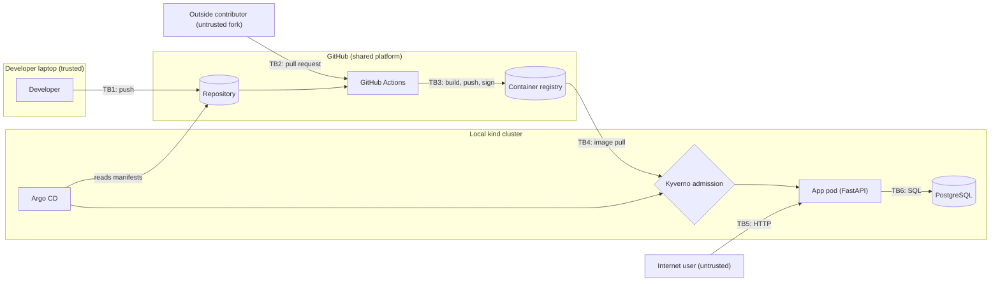

# Threat model

> **Status:** v0.1, written in Chapter 0 before any application code exists. Every control below is **planned**. Each row's status changes to *Verified* only when a chapter shows the attack failing, with evidence.
> **Method:** the four-question framework, with STRIDE applied at each trust boundary.

## How to read this document

A threat model answers four questions:

1. **What are we building?** The system, what is valuable in it, and who might attack it.
2. **What can go wrong?** Threats found by walking each trust boundary with STRIDE.
3. **What are we going to do about it?** A control for each threat, and the chapter that builds it.
4. **Did we do a good job?** Evidence that each attack fails, linked as chapters are finished.

If a control in this project does not trace back to a threat listed here, it is decoration. If a threat here has no control, it is either a gap or a deliberate choice, and it must say which.

---

## 1. What are we building?

A pipeline and a local Kubernetes cluster that only run software whose security evidence is signed and verified. The workload is a small FastAPI service with a PostgreSQL database, in two versions: deliberately `vulnerable` and `hardened`.

TB7 (not drawn) is the boundary *inside* the cluster: between pods, and between a pod and the Kubernetes API.

### Assets: what an attacker wants

| ID | Asset | Why it matters |
| --- | --- | --- |
| A1 | Data in PostgreSQL | The obvious prize. The data is synthetic, but it is treated as if it were real customer data. |
| A2 | Secrets: database password, token-signing key | With these, an attacker *becomes* the app or a user, without exploiting anything. |
| A3 | The signing identity | The cluster trusts whatever this pipeline signs. Whoever can trigger a signature controls what runs. |
| A4 | Write access to `main` | Argo CD deploys what `main` says. Changing `main` changes production. |
| A5 | Control of the cluster (Kubernetes API) | Everything else falls once an attacker can create pods or read Secrets. |
| A6 | Pipeline credentials (`GITHUB_TOKEN`, registry push rights) | A shortcut to A3 and A4. |
| A7 | The audit trail | An attacker who can erase "who deployed what" can hide everything else. |
| A8 | Availability | A service nobody can reach has failed, even if nothing leaked. |

### Threat actors: who might attack

| Actor | What they can reach | Realism in this lab |
| --- | --- | --- |
| Anonymous internet user | The app's HTTP endpoints (TB5) | Simulated: the app is only exposed on the laptop, so attacks are run against it locally |
| Malicious outside contributor | Pull requests from a fork (TB2) | Real: the repository is public |
| Compromised upstream dependency | Our build, through a package or base image (TB3) | Real and common |
| Compromised third-party GitHub Action | Our pipeline, with its permissions (TB2, TB3) | Real |
| Attacker holding a stolen GitHub token | Direct pushes and workflow runs (TB1) | Real: phishing and leaked tokens happen |
| Attacker who has already broken into the app pod | Other pods, the database, the Kubernetes API (TB6, TB7) | Assumed. We plan for the app being compromised. |
| The maintainer making a mistake | Everything | The most likely actor of all (see Chapter 0, "What broke") |

---

## 2 and 3. What can go wrong, and what we will do about it

STRIDE: **S**poofing · **T**ampering · **R**epudiation · **I**nformation disclosure · **D**enial of service · **E**levation of privilege.

### TB1: Developer laptop → repository

| ID | STRIDE | Threat | Planned control | Chapter | Maps to | Status |
| --- | --- | --- | --- | --- | --- | --- |
| T01 | I | A secret is committed to the public repository | Gitleaks before every commit and again in CI | 0, 2 | A04:2025, CICD-SEC-6 | Partly in place: the pre-commit hook has been installed since Chapter 0, Step 1 |
| T02 | S, T | Someone with a stolen token pushes straight to `main` | Branch protection: pull requests and passing checks required | 8 | CICD-SEC-1 | Planned |

### TB2: Untrusted pull request → pipeline

| ID | STRIDE | Threat | Planned control | Chapter | Maps to | Status |
| --- | --- | --- | --- | --- | --- | --- |
| T03 | E | **Poisoned pipeline execution:** a fork PR edits a workflow to read secrets or sign an image | No privileged triggers on untrusted code; signing and deployment only from `main`, behind environment rules | 8 | CICD-SEC-4 | Planned |
| T04 | T | A third-party action is replaced by a malicious version under the same tag | Actions pinned to a full commit SHA; workflow linting | 8 | CICD-SEC-7, CICD-SEC-8 | Planned |

### TB3: Pipeline → registry (build, push, sign)

| ID | STRIDE | Threat | Planned control | Chapter | Maps to | Status |
| --- | --- | --- | --- | --- | --- | --- |
| T05 | T | A look-alike or hijacked package enters the build | Hash-pinned dependencies; dependency scanning | 3 | A03:2025, CICD-SEC-3 | Planned |
| T06 | I, E | A dependency or base image with a known vulnerability is shipped | Trivy dependency and image scans; base image pinned by digest | 3 | A03:2025 | Planned |
| T07 | E | A pipeline job holds more permissions than it needs, so any compromise of it goes further | Read-only token by default; write permissions granted per job; build, sign, and deploy in separate jobs | 8 | CICD-SEC-2, CICD-SEC-5 | Planned |

### TB4: Registry and Git → cluster

| ID | STRIDE | Threat | Planned control | Chapter | Maps to | Status |
| --- | --- | --- | --- | --- | --- | --- |
| T08 | S, T | An image built outside the pipeline is pushed and deployed | Keyless signing in CI; Kyverno admits only images signed by this repository's workflow | 5 | A08:2025, CICD-SEC-9 | Planned |
| T09 | T | A tag such as `latest` is moved to point at a different image | Deploy by digest, never by tag | 5, 6 | A08:2025 | Planned |
| T10 | E | A privileged or root container is deployed | Kyverno policies plus Pod Security admission | 4 | A02:2025 | Planned |
| T11 | T | The release decision is bypassed and an image deploys without its scan results passing | Signed evidence bundle checked by OPA before signing; Argo CD syncs only approved manifests | 6 | CICD-SEC-1 | Planned |

### TB5: Internet user → app

| ID | STRIDE | Threat | Planned control | Chapter | Maps to | Status |
| --- | --- | --- | --- | --- | --- | --- |
| T12 | T, I | SQL injection | Parameterized queries; Semgrep; ZAP | 1, 2, 7 | A05:2025 | Planned |
| T13 | E, I | A user reads another user's records by changing an ID | Ownership check on every record route; authorization tests | 1, 2 | A01:2025 | Planned |
| T14 | S | Forged or never-expiring login tokens | Strict algorithm list, enforced expiry, key from a Secret | 1, 2 | A07:2025, A04:2025 | Planned |
| T15 | D, S | Password brute force against login | Rate limiting and lockout (a design control; no scanner finds its absence) | 1 | A06:2025 | Planned |
| T16 | I | Error pages leak stack traces and internals | Generic error responses; failure-path tests; ZAP | 1, 7 | A10:2025 | Planned |

### TB6: App → database

| ID | STRIDE | Threat | Planned control | Chapter | Maps to | Status |
| --- | --- | --- | --- | --- | --- | --- |
| T17 | I | The database password is hard-coded in code or baked into the image | Injected at runtime as a Kubernetes Secret; Gitleaks; image scan | 1, 2 | A04:2025, A02:2025 | Planned |

### TB7: Inside the cluster

| ID | STRIDE | Threat | Planned control | Chapter | Maps to | Status |
| --- | --- | --- | --- | --- | --- | --- |
| T18 | E | An attacker in the app pod moves to other pods, the database, or the Kubernetes API | Default-deny NetworkPolicy; no service-account token mounted unless needed; least-privilege RBAC | 4 | A01:2025, A02:2025 | Planned. **Open question:** confirm kind's default network plugin enforces NetworkPolicy |

### Across all boundaries

| ID | STRIDE | Threat | Planned control | Chapter | Maps to | Status |
| --- | --- | --- | --- | --- | --- | --- |
| T19 | R | Nobody can prove which commit and which workflow produced a running pod | Build-provenance attestation; Argo CD sync history | 5, 6 | CICD-SEC-10, A09:2025 | Planned |
| T20 | R | Failed logins and blocked deploys leave no record | Structured audit logs and alert rules | 9 | A09:2025 | Planned |
| T21 | D | **The gate itself fails:** the policy engine or signature check is down, so no deploy can happen, including an emergency fix | Decide fail-closed or fail-open in an ADR; test a documented break-glass path | 9 | — | Planned. **This is the project's uncomfortable tradeoff** |

---

## Out of scope, and why

A threat model is honest about its edges. These are excluded on purpose:

| Excluded | Why |
| --- | --- |
| Compromise of the developer's laptop itself | It is the root of trust for this lab. If it falls, every control can be bypassed. Production would use hardware keys and managed devices. |
| Compromise of GitHub or the public Sigstore infrastructure | Platform risks outside this project's control. Production would monitor provider advisories and could run private signing infrastructure. |
| Container-escape and kernel zero-days | Beyond a lab's scope; partly mitigated by non-root, read-only containers (T10). |
| Large-scale network DDoS | The app is not exposed to the internet. Production would put a CDN or WAF in front. |
| Real personal data and compliance regimes | All data is synthetic; nothing here claims compliance with any standard. |
| Cloud IAM and networking | There is no cloud account in this project. A later project covers that. |

## Assumptions

- A single maintainer, with GitHub multi-factor authentication enabled.
- The repository is public; the cluster is local and not reachable from the internet.
- Data is synthetic and contains no personal information.
- Tool behaviour (for example, which network plugin enforces NetworkPolicy) is verified in the chapter that relies on it, not assumed.

## 4. Did we do a good job?

- A threat moves to **Verified** only when its chapter shows the attack *failing*, with linked evidence.
- At the end of each chapter, this document is reviewed: new threats discovered while building are added, and statuses are updated.
- Version history is the Git history of this file.
